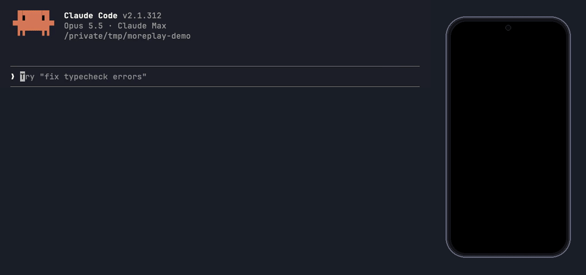
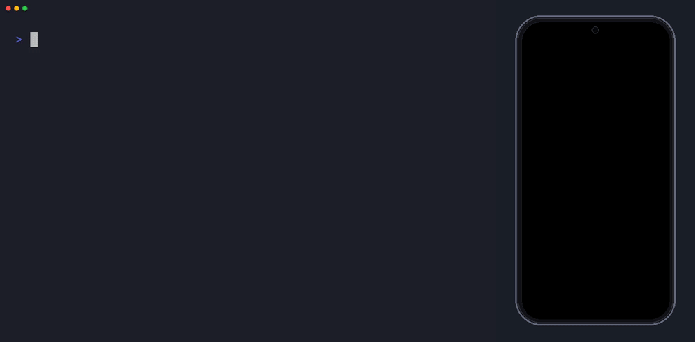

# droidreplay

[](https://www.npmjs.com/package/droidreplay)
[](https://github.com/JastinXyz/droidreplay/actions/workflows/ci.yml)
[](LICENSE)



Let an AI assistant use your Android phone. It can read the screen, tap, type and scroll, and
once it has done a task, you can save the steps and replay them later without the AI.

droidreplay is an [MCP](https://modelcontextprotocol.io) server: a plugin that gives AI apps
such as Claude Code, Claude Desktop or Cursor new tools. This one gives them an Android phone.

- **Fast.** Reading the screen takes about 50 ms, not the usual 3 seconds.
- **Cheap on tokens.** A screen is 1-2 KB of text, and the tools add only ~850 tokens to each request.
- **Record once, replay for free.** Save what the AI did as a small YAML file and run it again
  with one command, no AI needed. Handy for repeating manual tests.

## Quick start

### 1. What you need

- A computer with [Node.js](https://nodejs.org) 20 or newer.
- `adb`, the tool that talks to Android phones:
  - macOS: `brew install android-platform-tools`
  - Windows / Linux: download [SDK Platform-Tools](https://developer.android.com/tools/releases/platform-tools)
    and add the folder to your `PATH`.
- An Android phone (Android 8 or newer) and a USB cable. An emulator works too.

### 2. Turn on USB debugging

1. On the phone, open **Settings > About phone** and tap **Build number** seven times. This
   unlocks **Developer options**.
2. Open **Developer options** and turn on **USB debugging**.
   - Xiaomi, Redmi and POCO phones: also turn on **USB debugging (Security settings)**, or
     taps will not work.
3. Plug the phone in and tap **Allow** on the "Allow USB debugging?" prompt.

### 3. Check that it works

```bash
npx -y droidreplay doctor
```

This checks adb, your phone, and the droidreplay agent. It taps nothing. Lines with ✓ are
fine; a ✗ comes with a hint on how to fix it.

### 4. Add it to your AI app

**Claude Code**

```bash
claude mcp add droidreplay -- npx -y droidreplay
```

**Claude Desktop, Cursor and other MCP apps**: add this to the app's MCP config file
(Claude Desktop: Settings > Developer > Edit Config; Cursor: `.cursor/mcp.json`):

```json
{
  "mcpServers": {
    "droidreplay": {
      "command": "npx",
      "args": ["-y", "droidreplay"]
    }
  }
}
```

Restart the app, and you are done.

### 5. Try it

Ask your assistant things like:

- "What is on my phone screen right now?"
- "Open Settings and turn on dark mode."
- "Open the Clock app and set a timer for 5 minutes."
- "Log in to my app with test@example.com, then save the steps as a flow called login."

**Already have another phone tool, like mobile-mcp?** Name the one you want, so the assistant
does not pick the other:

- "Use droidreplay to open Settings and turn on dark mode."
- "With droidreplay, check what is on the screen and save a screenshot to ./shots/home.jpg."

Only one of them can control the phone at a time. If droidreplay says another tool holds the
connection, turn the other MCP server off in your AI app (in Claude Code: `/mcp`), or ask the
assistant to stop using it.

Nothing is installed on the phone. A small agent (17 KB) is copied to `/data/local/tmp` and
runs only while your AI app is using droidreplay.

## Replay without the AI

Ask the assistant to record a task ("start recording a flow called login"), let it do the
task, then ask it to save the flow. You get a file like `.droidreplay/flows/login.yaml` (or wherever you ask it to save).

Passwords and PINs stay out of the file: give them as variables when recording ("record a flow
called login with the variable pin = 482913"), and the saved flow says `${pin}` wherever the
value was typed. Pass the real value again when you replay it.

```yaml
name: login
dismiss: [Not now]             # tapped away whenever it shows up (ads, prompts)
steps:
  - launch: com.example.app
  - tap: Sign in
  - type: {field: Email, value: "${email}"}
  - wait_for: Home
  - screenshot: login-ok
```

You can also write or edit these files by hand. Run one from the terminal:




```bash
npx droidreplay run login --var email=test@example.com
```

```
RUN  .droidreplay/flows/login.yaml  5 steps

  ✓ launch com.example.app         234 ms
  ✓ tap "Sign in"                  148 ms
  ✓ type "${email}" into "Email"   390 ms
  ✓ wait_for "Home"                812 ms
  ✓ screenshot login-ok            170 ms

PASS  5 steps in 2.1 s
Evidence  .droidreplay/evidence/login/20261027-123950
```

Each step waits for its button or text to appear, so there are no fixed sleeps. The command
exits with 0 when every step passed and 1 when one failed, so it works in CI too.
Screenshots are saved in `.droidreplay/evidence/<flow>/<time>/` (or pass `--evidence <folder>`).
Commit the flows you want to keep, and add `.droidreplay/evidence/` to your `.gitignore`.

A folder runs as a suite: every `.yaml` directly in it, by name (subfolders such as `shared/`
hold subflows and are not run on their own). Tag flows with `tags: [smoke]` to pick some:

```bash
npx droidreplay run e2e/mobile --include-tags smoke --var pin=$PIN
```

If a step breaks after the app changes, ask the assistant to run the flow. It sees which step
failed and the screen at that moment, and can fix that step for you.

Flows can reuse each other and handle screens that only sometimes appear:

```yaml
steps:
  - run_flow: {file: shared/enter-pin.yaml, vars: {PROMPT: "Enter your PIN"}}
  - run_flow:
      when: {visible: "Rate this app"}
      steps:
        - tap: "Not now"
```

### Maestro

Already using [Maestro](https://maestro.mobile.dev)? Flows convert both ways:

```bash
npx droidreplay export login > login.maestro.yaml
npx droidreplay import checkout.maestro.yaml --out .droidreplay/flows/checkout.yaml
```

Steps that have no equivalent on the other side are listed, never dropped silently.

## Tools

What your AI app gets:

| Tool | What it does |
|---|---|
| `observe` | Reads the screen as text, one line per button, text or field. |
| `act` | Runs a list of steps in one go: tap, type, scroll, wait, press a key, open an app, a deep link, install an APK, grant permissions or wipe an app's data, take a screenshot. Stops at the first step that fails and shows the screen. |
| `screenshot` | Saves a picture of the screen. The AI only looks at it when it asks to. |
| `flow` | Records steps, saves them as a flow, runs a saved flow, and fixes a broken step. |

## How fast

Reading the screen is **~40x faster** than mobile-mcp and **~70x faster** than `uiautomator
dump`, and the model reads **~9x less**, both per screen and in tool definitions on every
request.

Measured on one phone (Android 14, HyperOS), home screen, October 2026. Both MCP servers were
timed end to end from an MCP client on the laptop. Method and raw numbers:
[`spike/RESULTS.md`](spike/RESULTS.md).

**Speed** (lower is better)

| | droidreplay | mobile-mcp 1.0.14 | plain adb |
|---|---|---|---|
| Read the screen | **34-65 ms** | 1.6-2.5 s | 2.9-3.6 s |
| First read (starts the agent) | **1.3-4 s** | 4.7 s | 2.9-3.6 s |
| Tap x,y | **77-94 ms** | 115-309 ms¹ | 184 ms |
| Screenshot | **150-170 ms** to a file | 0.3-0.6 s, sent to the model | 1.1-1.4 s to a file |

**What the model reads**

| | droidreplay | mobile-mcp 1.0.14 | plain adb |
|---|---|---|---|
| One screen as text | **1-2 KB** | 14 KB | 54 KB XML |
| Tool definitions, every request | **~850 tokens** (4 tools) | ~7.5k tokens (34 tools) | n/a |
| A screenshot | **a file path** (the image only with `show: true`) | a ~47 KB JPEG every time | n/a |

¹ mobilecli 1.0.21, mobile-mcp's device layer, timed per CLI call. mobilecli also keeps an
on-device server, but it waits for the screen to settle (up to 2 s) before every read. Plain
adb means `uiautomator dump`, `input tap` and `screencap`.

## Troubleshooting

Run `npx -y droidreplay doctor` first; it names most problems.

- **No device found, or the device is "unauthorized"**: unplug and replug the phone, then tap **Allow** on the
  USB debugging prompt. If no prompt shows, turn USB debugging off and on again.
- **Taps do nothing on a Xiaomi, Redmi or POCO phone**: turn on **USB debugging (Security
  settings)** in Developer options, then reboot the phone.
- **"another tool holds the UiAutomation connection"**: only one automation tool can control the phone at a time.
  Close Appium, Maestro, uiautomator2 or mobile-mcp first.
- **Several phones connected**: pick one with `ANDROID_SERIAL=<serial>` (see `adb devices`).

## Contributing

Bug reports from more phones are the most useful thing right now; please include the model
and Android version. To build from source, see [CONTRIBUTING.md](CONTRIBUTING.md).
[docs/architecture.md](docs/architecture.md) explains how it works, and
[docs/roadmap.md](docs/roadmap.md) lists what is next.

## License

[MIT](LICENSE)
